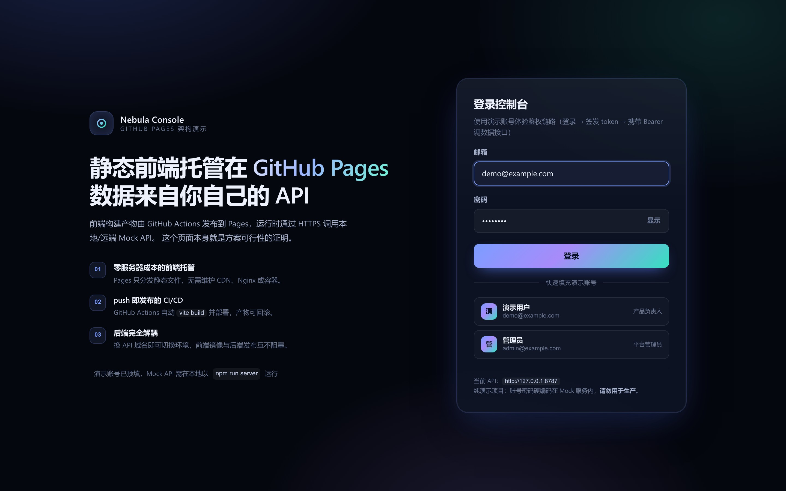
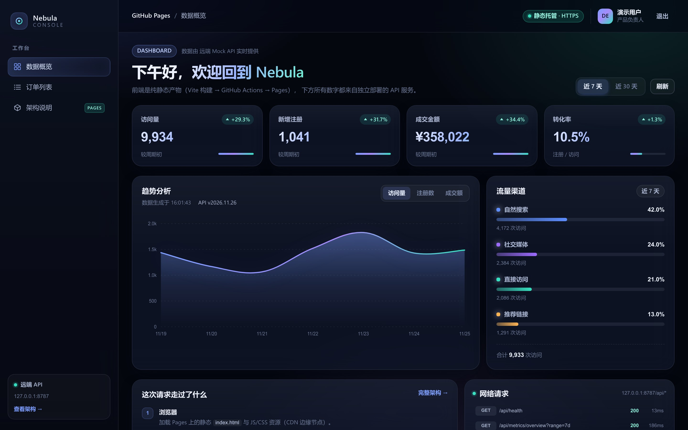
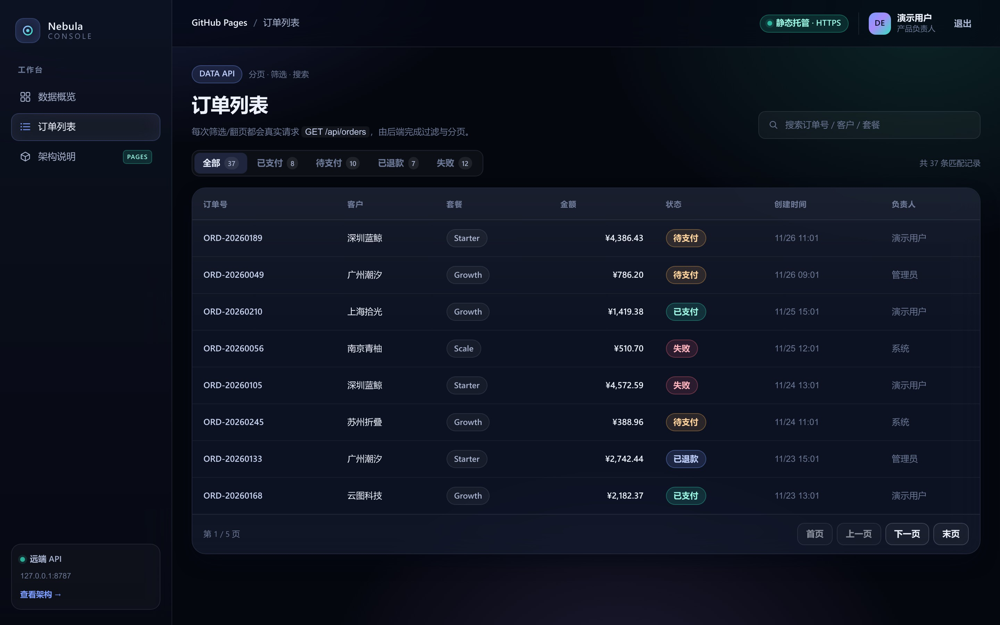
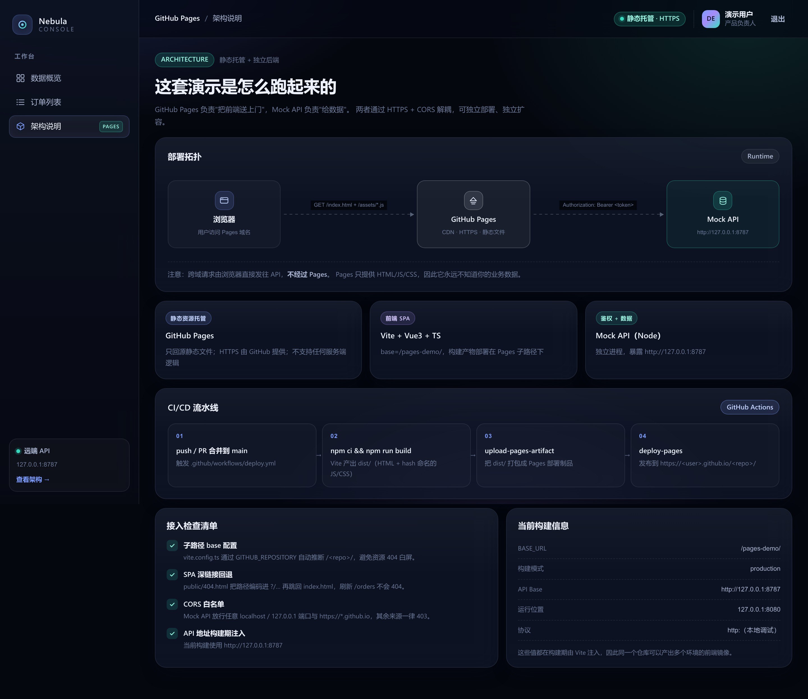

# Nebula Console · GitHub Pages 架构演示

一个「**前端托管在 GitHub Pages，数据来自独立 API**」的可运行演示。

- 前端：**Vite 7 + Vue 3.5 + TypeScript 5.9**（SPA，无 UI 框架、零运行时依赖膨胀）
- 后端：**零依赖 Node 内置模块**实现的 Mock API（登录鉴权 + 数据接口）
- 部署：**GitHub Actions → GitHub Pages**，产物走官方 `upload-pages-artifact` / `deploy-pages`

> 📄 完整方案文档：[docs/GitHub-Pages-对接方案.md](docs/GitHub-Pages-对接方案.md)



---

## 这份演示想说明什么

GitHub Pages **只能托管静态文件**，没有服务端、没有数据库、没有 rewrite。因此正确的架构是：

```
浏览器 ──① GET /index.html + /assets/*.js ──▶ GitHub Pages（CDN + HTTPS，只发静态文件）
   │
   └────② fetch /api/* + Authorization: Bearer ──▶ 自建 API（本地 Mock / 云端服务）
                                                  ↑ 不经过 Pages
```

前端只做「渲染 + 调接口」，所有鉴权逻辑与业务数据都在 API 侧。这样两套东西可以独立部署、独立回滚、独立扩容。

## 页面

| 数据概览 | 订单列表 |
| --- | --- |
|  |  |

架构说明页把部署拓扑、CI/CD 流水线、检查清单和当前构建参数都可视化出来了，方便评审时直接对着讲：



## 快速开始

```bash
npm install

# 终端 1：启动 Mock API（http://127.0.0.1:8787）
npm run server

# 终端 2：启动前端（http://127.0.0.1:5173，/api 走 Vite 代理）
npm run dev
```

打开 http://127.0.0.1:5173/ ，用预填的演示账号登录：

| 账号 | 密码 | 角色 |
| --- | --- | --- |
| `demo@example.com` | `demo1234` | 产品负责人 |
| `admin@example.com` | `admin1234` | 平台管理员 |

### 验证「部署到 Pages 后」的真实形态

本地 dev 走代理，看不到 CORS。用下面这条命令模拟 Pages 的部署形态
（子路径 + 绝对 API 地址 + 真实跨域预检 + 404 兜底）：

```bash
# 1) 按 Pages 的方式构建：子路径 /pages-demo/ + 绝对 API 地址
VITE_BASE=/pages-demo/ VITE_API_BASE_URL=http://127.0.0.1:8787 npm run build

# 2) 启动「Pages 行为模拟器」（未知路径返回 404 + 404.html，与线上一致）
npm run serve:pages
```

打开 http://127.0.0.1:8080/pages-demo/ ，并试试直接访问深链接：
http://127.0.0.1:8080/pages-demo/orders （会先 404 → 404.html 兜底 → 回到 SPA 路由）。

## 部署到 GitHub Pages

1. 把仓库推到 GitHub（公开仓库，或 Pro/Team 私有仓库）。
2. **Settings → Pages → Source** 选择 **GitHub Actions**。
3. **Settings → Secrets and variables → Actions → Variables** 新增：
   - `VITE_API_BASE_URL` = 你的 API 地址（例如 `https://api.example.com`）
   - 该变量在**构建期**被内联进 JS，改了变量必须**重新运行工作流**才生效
   - 若配在 **Environment** 作用域（Environments → `github-pages`），`build` job 已声明同名
     `environment`，可直接读取（此前缺这一步会导致变量读不到、前端退回同源 `github.io`）
4. push 到 `main`，等待 `Deploy to GitHub Pages` 工作流完成。
5. 访问 `https://<user>.github.io/<repo>/`。

> `base` 路径由 `vite.config.ts` 读取 `GITHUB_REPOSITORY` **自动推断**，无需手改。
> 若使用用户/组织站点（仓库名 = `<user>.github.io`），同样自动适配。

## 目录结构

```
pages-demo/
├─ index.html                      SPA 入口（含 ?__spa__ 路径还原）
├─ vite.config.ts                  base 自动推断 · /api 代理 · 构建期生成 404.html
├─ scripts/
│  ├─ spa-404.template.html        SPA 兜底页模板（按 base 注入路径深度）
│  └─ serve-pages-emulation.mjs    本地模拟 GitHub Pages 托管行为
├─ src/
│  ├─ api/client.ts                唯一后端边界：地址解析、Bearer、错误归一、请求日志
│  ├─ composables/useAuth.ts       会话状态（reactive 单例，替代 Pinia）
│  ├─ router/index.ts              路由守卫：会话恢复 → 未登录跳转
│  ├─ views/                       登录 / 概览 / 订单 / 架构 / 404
│  ├─ components/                  KPI 卡 / SVG 趋势图 / 渠道条 / 请求日志
│  └─ styles/main.css              设计令牌与原子类
├─ server/
│  ├─ index.mjs                    Mock API：路由、CORS、限流、HS256 token、请求日志
│  └─ data.mjs                     确定性种子数据
└─ .github/workflows/deploy.yml    CI/CD：build → artifact → deploy-pages
```

## Mock API

| 方法 | 路径 | 鉴权 | 说明 |
| --- | --- | --- | --- |
| GET | `/api/health` | — | 健康检查 |
| POST | `/api/auth/login` | — | 校验账号 → 签发 token（默认 2h） |
| GET | `/api/auth/me` | ✅ | 会话恢复 |
| POST | `/api/auth/logout` | ✅ | 无状态登出 |
| GET | `/api/metrics/overview?range=7d\|30d` | ✅ | KPI / 趋势序列 / 渠道占比 |
| GET | `/api/orders?status=&page=&pageSize=&q=` | ✅ | 服务端分页 / 筛选 / 搜索 |

环境变量见 [.env.example](.env.example)（`API_PORT`、`ALLOWED_ORIGINS`、`TOKEN_TTL` 等）。

## 关键设计点

| 问题 | 处理方式 |
| --- | --- |
| 项目站点子路径导致白屏 | `base` 由 `GITHUB_REPOSITORY` 自动推断为 `/<repo>/` |
| SPA 深链接 404 | 构建期生成 `dist/404.html`，把路径编码进 `?__spa__=` 后跳回并还原 |
| API 地址从哪来 | 构建期注入 `VITE_API_BASE_URL`（Actions Variables），统一收敛在 `api/client.ts` |
| 变量没注入时不静默失败 | `scripts/check-api-base.mjs` 让 CI 直接失败；运行时在登录页提示「API 地址未注入」 |
| 跨域鉴权 | `Authorization: Bearer`，**不用 Cookie**，规避 SameSite 问题 |
| `OPTIONS` 预检 | 在业务逻辑之前返回 204，不要求鉴权 |
| Chrome 私有网络访问 | 响应头带 `Access-Control-Allow-Private-Network: true` |
| 会话保持 | localStorage 存 token + 启动时 `/auth/me` 校验，失效即清理 |

## 已知边界（这是演示，不是产品）

- 账号密码硬编码在 Mock 服务内，token 用对称密钥签发；
- 「HTTPS 页面调本机 HTTP API」依赖浏览器把 `localhost` 视为安全来源，**访问者必须自己启动 API**；
- 未实现刷新 token、RBAC、数据库持久化、审计日志。

## 脚本一览

| 命令 | 作用 |
| --- | --- |
| `npm run dev` | 开发服务器（`/api` 代理到 8787） |
| `npm run server` | 启动 Mock API（8787） |
| `npm run build` | 类型检查 + 生产构建 |
| `npm run preview` | 预览生产构建（4173） |
| `npm run serve:pages` | 模拟 GitHub Pages 托管（8080，子路径 + 404 兜底） |
| `npm run typecheck` | 仅类型检查 |
| `npm run check:api-base` | 校验 `VITE_API_BASE_URL` 是否可用（CI 用） |

## 参考

- [GitHub Pages limits](https://docs.github.com/en/pages/getting-started-with-github-pages/github-pages-limits)
- [Publishing with a custom GitHub Actions workflow](https://docs.github.com/en/pages/getting-started-with-github-pages/configuring-a-publishing-source-for-your-github-pages-site)
- [MDN · Mixed content](https://developer.mozilla.org/en-US/docs/Web/Security/Defenses/Mixed_content)
- [rafgraph/spa-github-pages](https://github.com/rafgraph/spa-github-pages)

---

仅供架构演示，请勿将示例中的鉴权实现用于生产环境。
